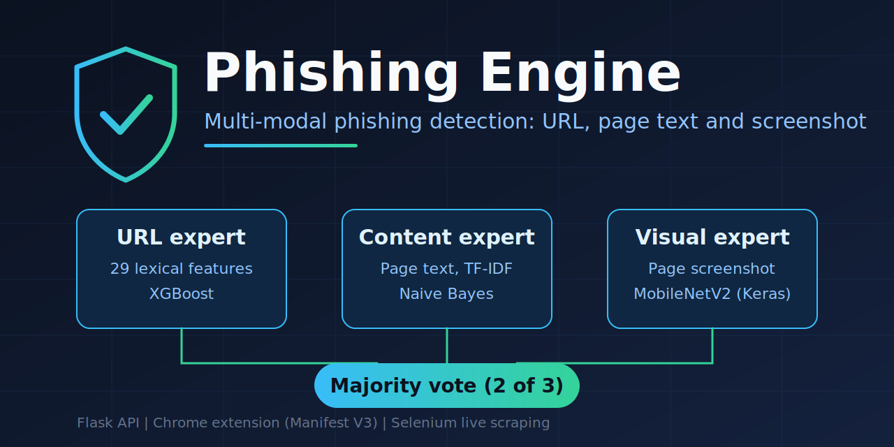
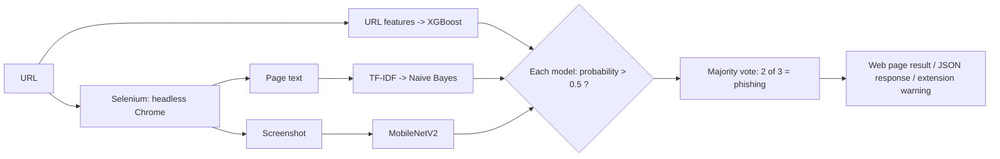

<p align="center">
  
</p>

<h1 align="center">Phishing Engine</h1>

<p align="center">
  A multi-modal phishing detector that scores a website from three angles (URL, page text and screenshot)
  and combines them by majority vote. It runs as a Flask web app, a JSON API and a Chrome extension.
</p>

<p align="center">
  
  
  
  
  
</p>

---

## Overview

Blocklist-based phishing filters miss new sites that have not been reported yet. This project looks at the page itself instead.
For every URL it visits the page in headless Chrome, collects the text and a screenshot, and asks three independent models whether the page looks like phishing. Two or more "phishing" votes flag the page.

| Expert | Input | Model | What it looks at |
|---|---|---|---|
| **URL expert** | The URL string | XGBoost | 29 lexical features: entropy, length, subdomain count, digit and letter ratios, suspicious keywords, `@`, IP-as-host and more |
| **Content expert** | Visible page text | TF-IDF (5,000 features, 1-2 grams) + Multinomial Naive Bayes | Bait wording such as account, verify and password prompts |
| **Visual expert** | Page screenshot (224x224) | MobileNetV2 transfer learning (Keras) | Whether the page looks like a phishing page |

## How a prediction is made



1. The URL is checked and scraped live (`app.py`, 25 s page-load timeout).
2. Each model outputs a phishing probability. A probability above 0.5 counts as one vote.
3. Two or more votes mean **phishing**, otherwise **legitimate**.

## Repository structure

```text
.
├── app.py                          Flask app: web UI, /predict (HTML) and /api/predict (JSON), live scraping
├── predict_phishing.py             Loads the models, URL feature extraction, text and image preprocessing
├── collect_data.py                 Phase 1: scrape URLs, page text and screenshots into master_dataset.csv
├── train_url_model.py              Phase 2: train the XGBoost URL model
├── train_nlp_model.py              Phase 3: train the TF-IDF + Naive Bayes text model
├── prepare_cv_data.py              Phase 4a: copy a balanced screenshot subset into cv_data_train/
├── Phishing_CV_Model_Training.ipynb  Phase 4b: train the CV model on Google Colab (GPU)
├── train_meta_model.py             Phase 5 (experimental): logistic-regression stacker, not used by the app
├── cv_phishing_model.keras         Trained CV model (committed)
├── templates/index.html            Web interface
├── chrome_extension/               Manifest V3 extension (manifest.json, background.js, warning.html)
├── assets/                         Cover image
└── requirements.txt
```

## Setup

> The URL and text models (`*.joblib`), the datasets (`*.csv`) and the screenshots are listed in `.gitignore`, so they are **not in the repository**.
> Only the CV model (`cv_phishing_model.keras`) is committed. Train the other models once before running the app.

**1. Install**

```bash
git clone https://github.com/Shalini2374/Phishing-Engine.git
cd Phishing-Engine
python -m venv venv
venv\Scripts\activate          # Linux/macOS: source venv/bin/activate
pip install -r requirements.txt
python -c "import nltk; nltk.download('punkt'); nltk.download('punkt_tab'); nltk.download('stopwords')"
```

Google Chrome must be installed. `webdriver-manager` downloads a matching driver automatically.

**2. Build the dataset** (`collect_data.py`)

Put these two files in the project folder:
- `tranco_top1m.csv`: the [Tranco](https://tranco-list.eu/) top-sites list (legitimate sites, 2 columns: rank, domain)
- `verified_online.csv`: the verified-online list from [PhishTank](https://phishtank.org/developer_info.php) (phishing sites)

```bash
python collect_data.py          # samples 2,000 + 2,000 sites, saves master_dataset.csv and screenshots/
```

**3. Train the models**

```bash
python train_url_model.py       # creates url_model_xgb_no_age.joblib
python train_nlp_model.py       # creates nlp_model.joblib and tfidf_vectorizer.joblib
python prepare_cv_data.py       # creates cv_data_train/ (500 screenshots per class)
```

The CV model was trained on Google Colab (T4 GPU) with `Phishing_CV_Model_Training.ipynb`, using a zip of `cv_data_train/`.
A trained copy is already in the repo as `cv_phishing_model.keras`.

**4. Run**

```bash
python app.py
```

Open http://127.0.0.1:5000/ and enter a URL. A check takes a few seconds to about 30 seconds because the page is loaded live.

## JSON API

```bash
curl -X POST http://127.0.0.1:5000/api/predict -d "url=https://example.com"
```

```json
{ "prediction": 0, "url": "https://example.com" }
```

`prediction` is `1` for phishing and `0` for legitimate. On a scraping or prediction failure the API returns an `error` message, `prediction: -1` and HTTP 500.

## Chrome extension

1. Start the Flask app (`python app.py`).
2. Open `chrome://extensions`, turn on **Developer mode**, click **Load unpacked** and select the `chrome_extension/` folder.
3. Browse normally. The extension sends each top-level navigation to `http://127.0.0.1:5000/api/predict`. If the result is phishing, the tab is redirected to `warning.html`, which shows the blocked URL.

If the backend is unreachable or returns an error, the extension lets the page load.

## Results

| Model | How it was evaluated | Result |
|---|---|---|
| URL (XGBoost, 29 features) | 20% stratified hold-out split, `train_url_model.py` | 99.1% accuracy (author's local run) |
| Content (TF-IDF + Naive Bayes) | 20% stratified hold-out split, `train_nlp_model.py` | 89.1% accuracy (author's local run) |
| Visual (MobileNetV2, frozen base) | 200 validation screenshots, notebook output | **65.0%** accuracy (confusion matrix `[[67, 33], [37, 63]]`) |
| Visual (ResNet50V2, tried, not used) | Same split | 61.5% accuracy |
| Majority-vote ensemble | Not yet evaluated end to end | n/a |

Scripts print full classification reports when you run them, so the first two rows can be reproduced.

## Known limitations

These are the current weak points and the next things to fix.

- **The screenshot model is the weakest expert** (65% on 200 images). It was trained on 1,000 screenshots with a frozen base, so it adds little signal today.
- **The URL score is probably optimistic.** Legitimate samples come from a top-sites list (mostly bare domains) and phishing samples are full URLs with paths, so the model can learn that difference instead of real phishing cues. Treat 99.1% as a dataset result, not a real-world accuracy.
- **Preprocessing mismatch for the CV model.** The notebook trains with pixels rescaled to 0-1 (`rescale=1/255`), while `predict_phishing.py` uses MobileNetV2's `preprocess_input` (range -1 to 1). Using the same scaling in both places is a planned fix.
- **The meta-model is not part of the app.** `train_meta_model.py` trains a logistic-regression stacker and evaluates it on the same data it was fitted on, so its accuracy is not a hold-out number. The app uses simple majority voting.
- **Failed model calls count as a "legitimate" vote** (probability defaults to 0).
- **Live scraping is slow** and the extension checks a page after navigation has started.
- **Development settings:** `app.py` runs Flask with `debug=True` on `0.0.0.0`. Use `127.0.0.1` and `debug=False` outside local testing.

## Roadmap

- Rebuild the dataset with legitimate and phishing URLs sampled the same way, and re-evaluate all models.
- Fine-tune the CV model on a larger screenshot set and match the preprocessing between training and inference.
- Evaluate the full majority-vote pipeline on a held-out set and compare it with a properly validated stacker.
- Cache results per domain to cut latency, and add tests for URL feature extraction.

## Tech stack

Python, Flask, Flask-CORS, XGBoost, scikit-learn, TensorFlow/Keras, NLTK, Selenium, BeautifulSoup, Pandas, NumPy, Joblib, Chrome Extension (Manifest V3).

## Author

**Shalini G S**, Integrated M.Tech Computer Science, VIT
[GitHub](https://github.com/Shalini2374) | [LinkedIn](https://www.linkedin.com/in/shalini-saravanan-8a3519268/)
